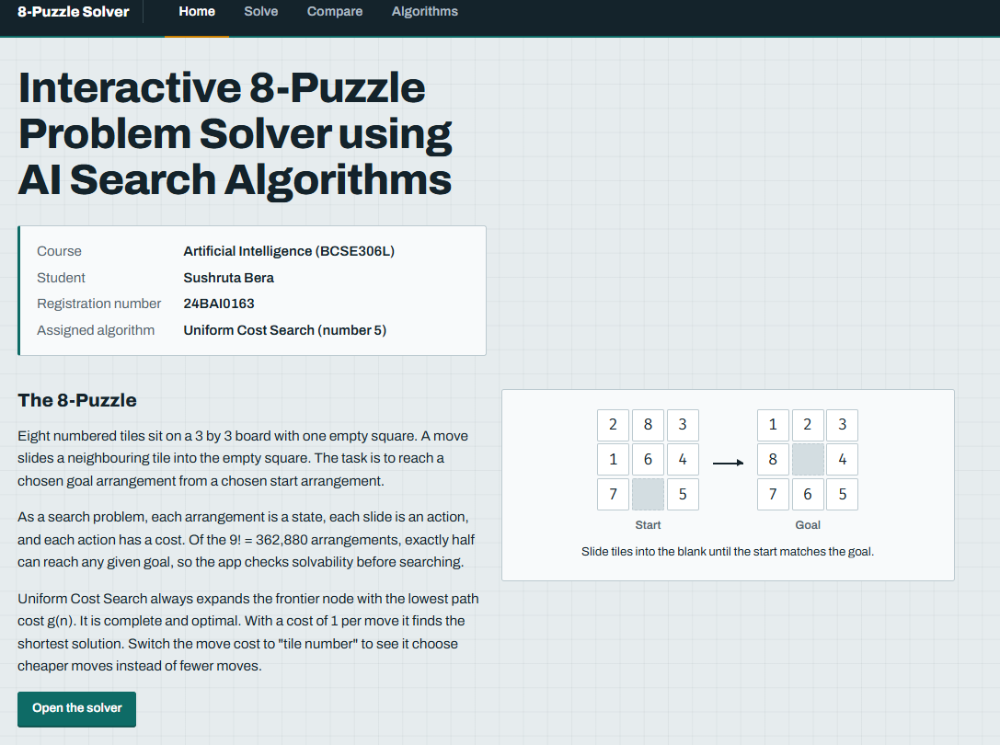
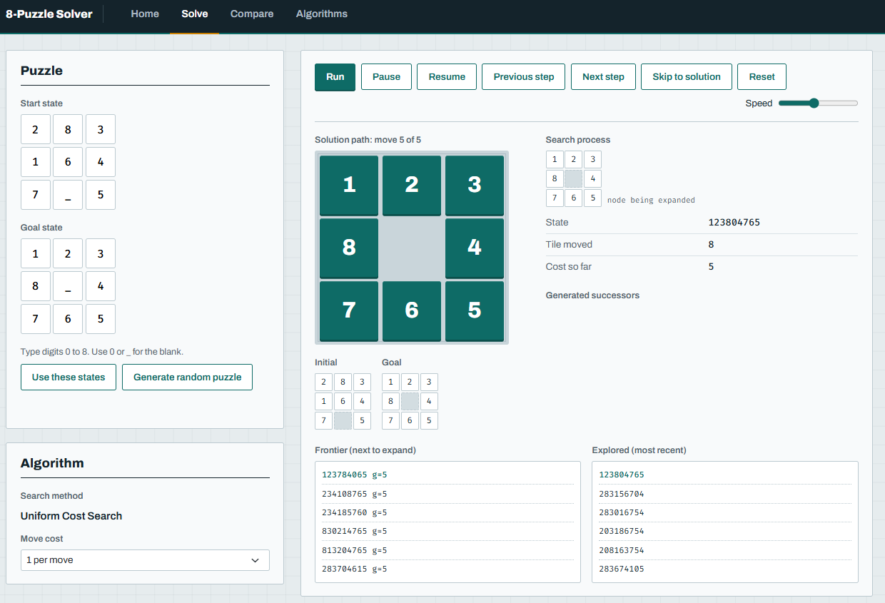
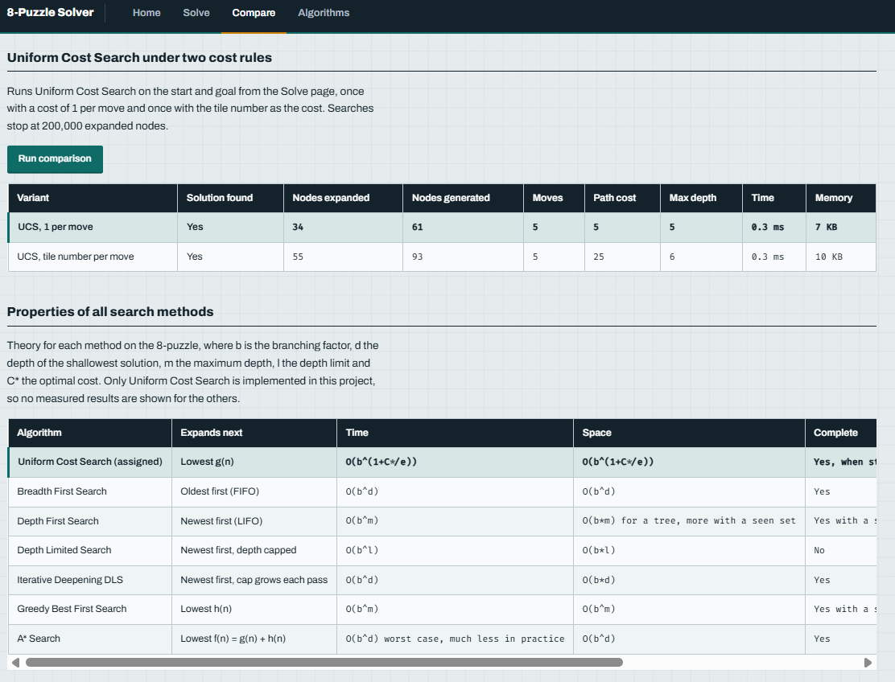

# AI 8-Puzzle Visualizer

Interactive 8-Puzzle solver for the Artificial Intelligence digital assignment. Assigned algorithm: **Uniform Cost Search (number 5)**.

## Technologies Used
HTML5, CSS3, JavaScript (ES6), Bootstrap 5.3 (CDN), Google Fonts (Archivo, Fira Code).

## Search Algorithms Implemented
Uniform Cost Search (assigned, with 1 per move or tile number move cost). The same engine in `js/solver.js` also runs BFS, DFS, DLS, IDDLS, GBFS and A* so the comparison page has data. All were written from scratch.

## Heuristics Used
Misplaced Tiles and Manhattan Distance (GBFS and A*).

## Screenshots
Home Page :

Solve :

Compare :

## GitHub Pages URL
https://sushrutabera.github.io/8-puzzle-Solver/

## Student Details
Name: Sushruta Bera. Registration number: 24BAI0163.

## References
Russell and Norvig, Artificial Intelligence: A Modern Approach, chapter 3. Bootstrap documentation.

## How to Run the Project
Open `index.html` in a browser. Or use the Github Pages link given above
